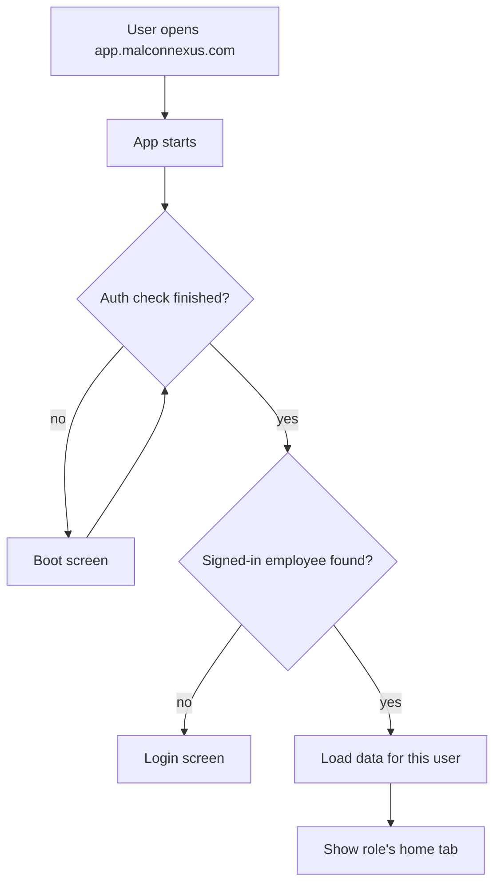
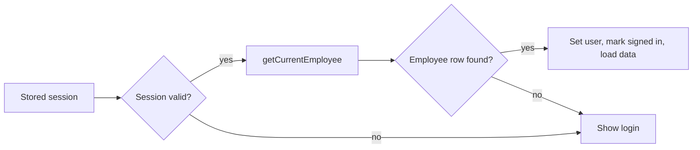
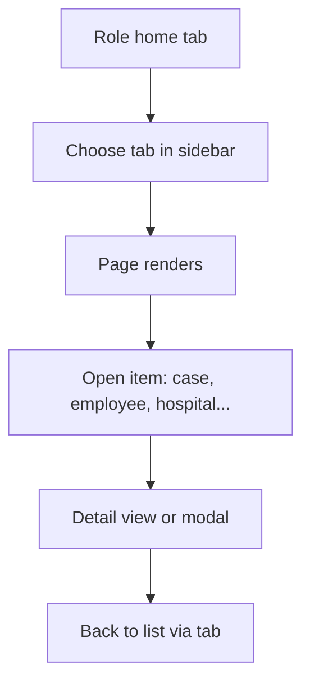
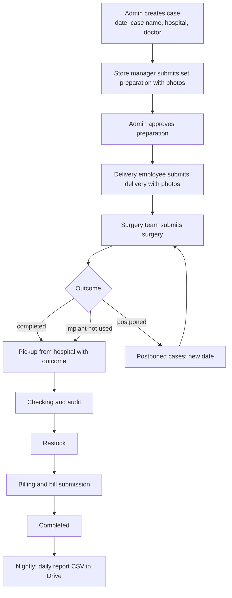

# Malcon Nexus — Application Flow

> Describes the screens and steps that exist in the code today. Verified on 2026-10-26.
> Status: ✅ implemented · 🟡 partial · ⚪ placeholder or disabled · ❓ unverified

---

## AI Agent Usage

- **What this document is for:** how a real user moves through the app, from opening it to finishing a case.
- **Read it when:** you change a screen, a tab, a permission check, or a flow that spans several screens.
- **Authoritative sections:** §3 (sign-in), §5 (roles and tabs), §9 (case flow), §11 (photo flow), §18 (report).
- **Do not infer from it:** that a screen not listed here is absent, or that a listed screen does everything its name suggests. Check the page file before changing behaviour.

---

## 1. Application Overview

Malcon Nexus has three entry points:

| URL | Screen | Who |
|---|---|---|
| `app.malconnexus.com` | Main application (sign-in, then role-based tabs) | Staff |
| `gallery.html` | Gallery of case photos (public feed, token-protected data) | Viewers |
| `tv.html` | TV kiosk | Displays in the office |

Inside the main app there is also a TV board tab (`tv-board`) for admins.

## 2. Application Entry



- The boot screen is `AppBootScreen`.
- If there is no session, `Login` is shown (`App.tsx`, when `REMOTE_AUTH` is true).
- The app listens for sign-in, token refresh and sign-out events. A sign-out returns to the login screen.

## 3. Authentication Flow

### 3.1 Admin: email and password

```
USER ACTION      Enters email and password on Login
↓
UI SCREEN        Login (src/pages/Login.tsx)
↓
APP LOGIC        authService.signIn → supabase.auth.signInWithPassword
↓
AUTHORIZATION    Supabase Auth validates credentials
↓
DATABASE/API     Session created; employee row loaded by auth_user_id
↓
RESULT           SIGNED_IN event → app sets current user and data loads
↓
NEXT             Admin home tab (Dashboard)
```

### 3.2 Employee and store manager: employee code and one-time code

```
USER ACTION      Enters employee code → requests a one-time code
↓
EDGE FUNCTION    request-login-otp: finds employee by code
↓
CHECKS           Admin → refused (use email login)
                 Petrol → refused (use the petrol login)
                 Inactive → refused
↓
RESULT           One-time code issued
↓
USER ACTION      Enters the code
↓
EDGE FUNCTION    verify-login-otp: checks code, returns a verification token
↓
APP              Completes sign-in with the token
↓
NEXT             Employee or store manager home tab
```

### 3.3 Petrol desk

The petrol desk has its own login (not documented in code beyond the refusal message). ❓ Verify the exact login screen before documenting.

### 3.4 Not in the app

- Password reset: ❓ not found.
- Self sign-up: ❓ not found. Admins create logins through `create-employee-login`.

## 4. Session Initialization



- Session is restored by the Supabase client.
- Cached data is shown first from `bootstrapSessionCache`, then refreshed.
- Token refresh keeps the session alive. Sign-out clears the signed-in state.

## 5. Role Resolution

The role comes from the signed-in employee's record. It sets `viewMode`:

| Role (`employees.role`) | viewMode | Home tab | Tabs available |
|---|---|---|---|
| `admin` | `admin` | Dashboard | Full admin list (§5.1) |
| `employee` | `employee` | Employee dashboard | Own dashboard; Settings (profile) |
| `store_manager` | `store_manager` | Case duties page | Case duties; Dashboard, Cases, Live cases, Workflow, Settings |
| `petrol` | `petrol` | Petrol dashboard | Petrol dashboard; Settings |

### 5.1 Admin tabs (`App.tsx` `renderPage`)

Dashboard · Cases · Live cases · Notes · Workflow · Postponed cases · Approvals · Task requests (currently falls back to Dashboard, see ⚪) · Employees · Telegram · Attendance · Attendance approvals · Expenses · Petrol dashboard · Food dashboard · KMs dashboard · Hospitals · Doctors · Reports · Case history · Activity log · Settings · TV board.

### 5.2 Super admin

Super admins are admins with extra rights. They are the only users who can open stage photos. The rule is decided in the database (`is_super_admin()`) and in the client email list. Two sources; see TRD §24.

## 6. Main Navigation

- **Desktop:** left sidebar (`src/components/layout/Sidebar.tsx`) lists the tabs for the role. Top bar (`TopBar.tsx`) has the sign-out action.
- **Phone:** a bottom or top navigation pattern is used by the layout; the exact mobile nav was not traced line by line ❓.
- Tabs are state inside `App.tsx` (`activeTab`), not URL routes. A browser refresh returns to the home tab.



## 7. Dashboard Flow

```
USER ACTION      Opens Dashboard (admin) or Employee dashboard
↓
UI SCREEN        Dashboard.tsx / EmployeeDashboard.tsx
↓
APP LOGIC        Reads cases and related data from the store
↓
AUTHORIZATION    Client shows what the role may see; database RLS limits the rows
↓
DATABASE/API     Data already loaded at sign-in; refreshed by events
↓
RESULT           Summary cards and lists
↓
NEXT             Open a case, or go to Approvals / Live cases
```

Admin insights text uses the `dashboard-insights` edge function (Gemini). Whether this is used in production is ❓ unverified.

## 8. Employee Flow

```
USER ACTION      Signs in as employee
↓
UI SCREEN        Employee dashboard (own assigned cases)
↓
DATABASE         cases visible through RLS: assigned, or assignee on the open stage
↓
NEXT             Open an assigned case → submit the current stage (§9)
                 Attendance, leave, expenses, food, petrol (where enabled)
```

Employees only see cases they are assigned to, or assistant on, or assignee on the open stage (RLS policy `cases_employee_assigned`).

## 9. Case / Operations Flow

### 9.1 Create a case

```
USER ACTION      Admin or case operations user presses Add case
↓
UI SCREEN        QuickCreateCaseModal, five steps
↓
STEP 1           Surgery date and case name (case name is saved in implant_required)
STEP 2           Hospital (search, keyboard) and doctor (picker, keyboard)
STEP 3           Company, implant type, priority
STEP 4           Team (punched-in person for admins; assignments)
STEP 5           Review → Create
↓
APP LOGIC        Validation returns the first missing field; error appears on its step
↓
AUTHORIZATION    Client check for role; database RLS and save function check writes
↓
DATABASE/API     Case inserted/updated through the case write path
↓
RESULT           Case created; case number MLS-MM-YY-NNN from the surgery month
↓
NEXT             Case detail page
```

Keyboard: in the hospital search, arrow keys move the highlight and Enter selects. In the doctor picker, typing highlights the first match and Enter selects it. To add a new doctor, arrow to the "Add to master list" row and press Enter.

### 9.2 Submit a stage

```
USER ACTION      Assigned employee opens a case and presses the stage action
↓
UI SCREEN        SubmitStageModal (case header, notes, photos)
↓
CHECKS           Client: assignment and stage rules
                 Server: save function rejects writes from non-assigned users
↓
PHOTOS           Take or pick up to 10 photos → compressed and stamped on device
↓
DATABASE/API     Photos uploaded (§11); stage record and activity written
↓
RESULT           Stage marked submitted; case moves to next stage or waits for approval
↓
NEXT             Approval queue (admin), or the next stage owner's task
```

Stage types and their extra fields:
- **Set Preparation:** photos required for store managers.
- **Surgery:** notes required only when completed. Postpone (new date) and "not performed, implant not used" do not need photos.
- **Pickup from hospital:** outcome: used with no return, or parked.
- **Restock:** outcome: restocked, not restocked, or order.

### 9.3 Approval

```
USER ACTION      Admin opens Approvals
↓
UI SCREEN        ApprovalQueue
↓
ACTION           Approve, or reject / request changes with a reason
↓
DATABASE/API     approvals table and case status update
↓
RESULT           Case status updated; activity logged
↓
NEXT             Case moves on, or goes back to the submitter
```

### 9.4 Postpone and cancel surgery

- **Postpone:** choose a new date. The case stays at Surgery. Shown in Postponed cases.
- **Cancel (implant not used):** the case moves to pickup. Shown as cancelled reason.

### 9.5 Other case screens

| Screen | Purpose | Status |
|---|---|---|
| Cases | List and search cases | ✅ |
| Live cases | Cases in progress now | ✅ |
| Workflow board | Cases by stage | ✅ |
| Case detail | Stages, photos, comments, duties | ✅ |
| Case history | Closed and past cases | ✅ |
| Case duties | Post-surgery duties for store managers | ✅ |
| Task requests | Requests from the pool | ⚪ (pool disabled; screen falls back to Dashboard) |
| Notes | Internal notes | ❓ |

## 10. Delivery Flow

Delivery is a stage with its own submission (§9.2). The delivery owner is assigned by department. Photos follow the same rules. ✅

## 11. Photo / File Upload Flow

```
USER ACTION      Takes or picks a photo in SubmitStageModal
↓
UI SCREEN        StagePhotoCapture (up to 10; shows count)
↓
APP LOGIC        Compress to a JPEG, stamp name, ID and time; limit 5 MB
↓
AUTHORIZATION    Edge function checks signed-in user, employee profile, case assignment
↓
API              upload-stage-photo edge function → Apps Script web app
↓
STORAGE          Google Drive: Year / Month / Date / Case / Stage / file.jpg
↓
RESULT           Document saved on the case: driveFileId and thumbnail URL
↓
NEXT             Thumbnail in case gallery; View opens the Drive file
```

**Viewing a photo**
- Gallery shows a thumbnail, loaded only when the viewer opens.
- Only super admins see the thumbnail and View link. Other users see "N photos submitted".
- View opens the full file in Drive in a new tab.

**Old photos:** photos taken before the Drive change are in Supabase Storage (private bucket). Super admins see them through short-lived signed links. Migration of these to Drive is 🔵 planned.

## 12. Search Flow

```
USER ACTION      Types in a search box (cases, employees, hospitals, doctors)
↓
UI SCREEN        Search field in the page
↓
APP LOGIC        Filters loaded data in memory
↓
RESULT           Matching rows
↓
NEXT             Open a row
```

- Hospital search matches name, branch, city and address; results are capped at 40. ✅
- Doctor search matches name and doctor code. ✅
- Location-based hospital search uses the `location-hospital-search` function (Mappls). 🟡

## 13. Filtering Flow

Case lists filter by stage, status and text. The exact filter controls differ between screens; ❓ per screen.

## 14. Notification Flow

```
EVENT            Case activity or assignment
↓
ROUTE            In-app notification row; optional Telegram, email or web push
↓
RESULT           User sees notification badge or message
↓
NEXT             Open the case
```

Channel status: in-app ✅; Telegram, email and web push 🟡 (code present; live configuration not verified).

## 15. Admin Flow

| Task | Screen | Status |
|---|---|---|
| Create or edit employee; set up login | Employees | ✅ |
| Manage hospitals | Hospitals | ✅ |
| Manage doctors | Doctors | ✅ |
| Approve attendance | Attendance approvals | 🟡 |
| Approve cases | Approvals | ✅ |
| See activity | Activity log | ✅ |
| Reports | Reports | 🟡 |
| Telegram setup | Telegram | 🟡 |
| Settings | Settings | ✅ |

## 16. Settings Flow

- Settings shows the user's profile and app settings. Employees see it as "Profile".
- Changing a login email goes through `update-employee-login-email` (admin). ✅

## 17. Error Flow

```
USER ACTION      Submits something that fails
↓
CHECK            Client validation first (missing fields)
↓
SERVER           Edge function or database error
↓
RESULT           Message near the field, or a red banner in the modal
↓
NEXT             Fix and retry; nothing is half-saved for case writes (single function)
```

- Edge functions return `{ error }` with a status code.
- The case write function raises readable messages (for example, "This case is assigned to …").
- Hostinger upload errors are a deploy issue, not an app flow.

## 18. Loading States

- Boot screen while checking the session.
- Spinners on buttons while submitting (`Loader2`).
- Photo processing message ("Adding name, ID, date & time…").
- Data hydration banner while data loads after sign-in (`DataHydrationBanner`).

## 19. Empty States

- Lists show a short message when nothing matches (for example, "No hospital matches …", "No doctors on the master list yet").
- Dashboards show zero counts. Visual empty states beyond text were not traced for every screen ❓.

## 20. Logout Flow

```
USER ACTION      Presses sign out in the top bar
↓
APP LOGIC        authService.signOut()
↓
RESULT           SIGNED_OUT event; signed-in state cleared; data cleared from memory
↓
NEXT             Login screen
```

## 21. Complete Application Journey (typical day)



Stage order and parallel steps follow the rules in `src/lib/caseWorkflow.ts`. The diagram shows the common path, not every branch.

## 22. Application State Transitions

| From | Event | To |
|---|---|---|
| Boot | No session | Login |
| Boot | Session + employee | Home tab |
| Login | Sign-in succeeds | Home tab |
| Home | Sign-out | Login |
| Case | Stage submitted | Next stage, or Waiting For Approval |
| Waiting For Approval | Admin approves | Next stage |
| Waiting For Approval | Admin rejects / requests changes | Back to submitter |
| Surgery | Postponed | Surgery (new date) |
| Any open stage | Cancelled (implant not used) | Pickup |
| Completed stages | Billing done | Completed |

## 23. Documentation Confidence & Gaps

| Area | Confidence | Gap |
|---|---|---|
| Sign-in (admin, employee code) | High | Petrol login screen not read |
| Role tabs | High | Mobile navigation not traced line by line |
| Case creation | High | Validation messages for every field not all checked |
| Stage submission | High | Every stage's extra rules not traced |
| Photo flow | High | Old-photo viewing path not tested |
| Notifications | Medium | Live channels unverified |
| Filters and empty states | Low | Per-screen detail not traced |
| Reports | Low | Not verified |
