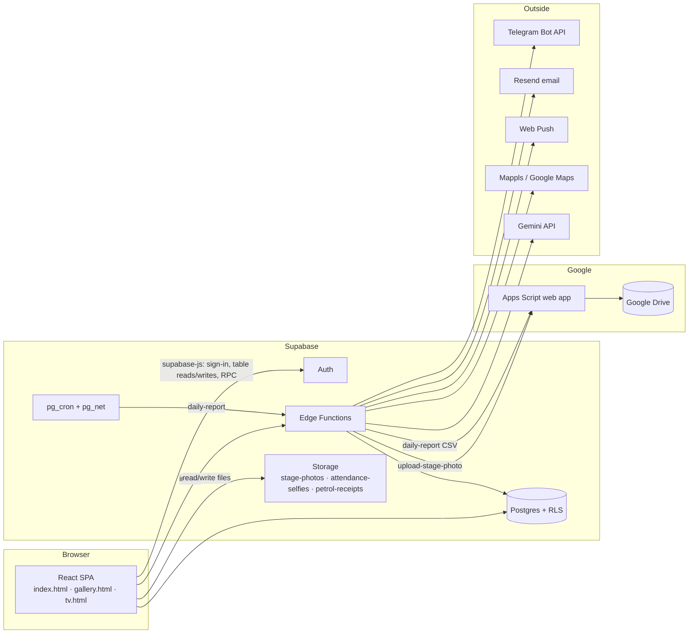
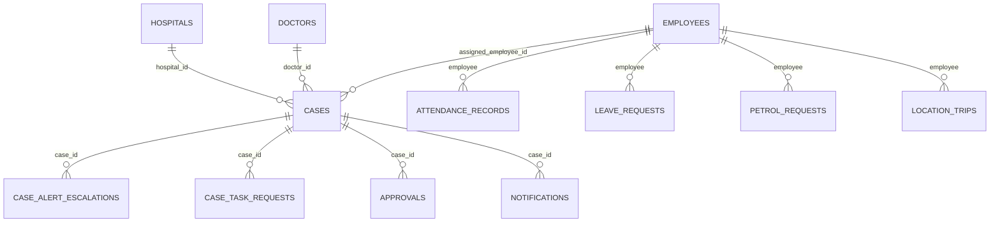

# Malcon Nexus — Technical Requirements & Architecture Document

> Status legend: ✅ VERIFIED · 🟡 PARTIAL · ❓ UNVERIFIED · ⚪ LEGACY/DEAD
> Verified against the repository and the live database (read-only queries) on 2026-10-26.
> No secret values are included. Environment variables are named, never valued.

---

## AI Agent Usage

- **What this document is for:** how Malcon Nexus is built and how its parts talk to each other.
- **Read it when:** you change data access, permissions, storage, edge functions, deployment, or any integration.
- **Authoritative sections:** §7 (frontend), §9–§16 (auth, database, RLS, storage), §22 (integrations), §24 (security findings), §28 (deployment).
- **Do not infer from it:** that a policy or table is safe because it exists. Check §15 and §24 first. Do not treat the `supabase/` migration files alone as the live schema; the live database is the reference for the table and policy lists here.

---

## 1. Executive Technical Summary

Malcon Nexus is a single-page React application built with Vite. It uses Supabase for authentication, Postgres, row-level security, edge functions and storage. The production build is static and hosted on Hostinger. Stage photos are uploaded through a Supabase edge function, which forwards them to a Google Apps Script web app that writes into Google Drive. A nightly job, scheduled in Postgres with `pg_cron`, builds a CSV of the day's cases and sends it to the same Apps Script.

The architecture is a "thick client" with a Supabase backend. Most reads and writes go from the browser straight to Supabase tables, with row-level security as the main permission gate. A few multi-step writes go through `SECURITY DEFINER` database functions.

## 2. System Architecture



## 3. Architecture Diagram

See §2. Three browser entry points are built from one code base (`vite.config.ts` multi-page build, `vite.gallery.config.ts`, `vite.tv.config.ts`):

| Entry | Purpose | Routing |
|---|---|---|
| `index.html` → `src/main.tsx` | Main application | Tab state in `App.tsx` (no URL routing) |
| `gallery.html` → `src/gallery-main.tsx` | Public gallery display | React Router (`GalleryPage`) |
| `tv.html` → `src/tv-main.tsx` | TV kiosk display | React Router (`TvKioskPage`) |

## 4. Technology Stack

| Layer | Technology (version from `package.json`) | Status |
|---|---|---|
| UI | React 19.2.6, Tailwind CSS 4.1.17, lucide-react, framer-motion, recharts | ✅ |
| Build | Vite 7.3.2, `@vitejs/plugin-react`, `vite-plugin-singlefile` (inlines JS/CSS into HTML) | ✅ |
| Language | TypeScript (`tsc --noEmit` is not a build gate; see §27) | ✅ |
| State | zustand 5.0.14 (`src/store/useStore.ts`) | ✅ |
| Routing | react-router-dom 7.18.1 (gallery and TV entries only) | ✅ |
| Backend client | @supabase/supabase-js ^2.110 | ✅ |
| Tables | @tanstack/react-table | 🟡 (dependency present; usage not traced) |
| Dates | date-fns | ✅ |
| Images | Browser canvas compression; `sharp` in dev deps (scripts) | ✅ / 🟡 |
| Export | html-to-image | 🟡 (not traced to a screen) |
| Backend functions | Supabase Edge Functions (Deno, `esm.sh` imports) | ✅ |
| Database | Supabase Postgres 17 | ✅ |
| Scheduler | `pg_cron` + `pg_net` (daily report) | ✅ |
| Photos | Google Apps Script web app → Google Drive | ✅ |
| Hosting (app) | Hostinger static hosting, deployed by `scripts/deploy-hostinger-app.mjs` | ✅ |
| Hosting (gallery) | GitHub Pages (`gallery-pages.yml`) | ✅ |
| Hosting (legacy) | Vercel build (`deploy-vercel.yml`, "legacy page") | ⚪ |

**Dependencies that should not be relied on:** `convex` and `pg` are listed in `devDependencies` in `package.json`. The Convex backend was removed on 2026-10-25, so the package is dead weight. `package.json` scripts for Convex, AWS, Cloudflare and D1 still exist and point to code that no longer exists (§31).

## 5. Repository Structure

```
malcon-nexus/
├── index.html · gallery.html · tv.html   # three browser entry points
├── src/
│   ├── main.tsx · App.tsx                 # app shell, auth gate, tab routing
│   ├── pages/        (29 screen files; see APP_FLOW.md)
│   ├── components/   (UI; case-create/ and case-detail/ subfolders)
│   ├── lib/          (auth, data access, roles, workflow rules, stage photos)
│   │   └── database/ (repository layer: database.ts chooses Supabase)
│   ├── store/useStore.ts                  # zustand global state
│   ├── types/index.ts                     # domain types (Employee, ImplantCase, …)
│   └── styles/nexus-theme.css             # design tokens and shared classes
├── supabase/
│   ├── functions/    (23 edge functions; see §17)
│   ├── migrations/   (73 SQL files; the live database is the reference)
│   ├── nexus-full-schema.sql              # schema reference file
│   └── config.toml   (JWT settings for some functions)
├── apps-script/stage-photos/              # Google Apps Script (copied into Apps Script by hand)
├── scripts/          (deploy, migration and test scripts; many are legacy)
├── docs/             (this document set and older notes)
└── .github/workflows/                     # build (Vercel legacy), gallery to GitHub Pages
```

## 6. Application Architecture

- **Shell:** `App.tsx` decides what to render from three inputs: whether a session exists, the employee's role (`viewMode`), and the active tab. `renderPage()` switches on the tab.
- **Role views:** `viewMode` is one of `admin`, `employee`, `store_manager`, `petrol` (`src/lib/roles.ts`, `viewModeForRole`). Each view has its own tab list and default screen.
- **Bootstrap:** after sign-in the app loads its data in one pass (`src/lib/database/bootstrap.ts`, cached by `bootstrapSessionCache.ts`). A `malcon-bootstrap-updated` window event triggers a reload when another write changes the data.
- **Repositories:** `src/lib/database/database.ts` picks the data layer. In this build it is always Supabase (`USE_SUPABASE`); the flags for the removed backends still exist in `cloudflareConfig.ts` and `workerReadConfig.ts` (⚪ dormant).

## 7. Frontend Architecture

| Concern | Where | Notes |
|---|---|---|
| Entry and providers | `src/main.tsx` | ❓ not traced in full |
| App shell and auth gate | `src/App.tsx` | Subscribes to `authService.onAuthStateChange` |
| Screens | `src/pages/*.tsx` | 30 files; see APP_FLOW.md |
| Shared UI | `src/components/ui/` (Modal, Button) | Modal uses framer-motion; bottom sheet on phones |
| Case creation | `src/components/QuickCreateCaseModal.tsx`, `src/components/case-create/` | Five steps; validation returns the first missing field |
| Case detail | `src/components/case-detail/` | Sections, stage photo album |
| Stage submission | `src/components/SubmitStageModal.tsx`, `StagePhotoCapture.tsx` | Photo capture, compression, notes |
| Stage photo logic | `src/lib/stagePhotos.ts` | Upload via edge function; view/thumbnail links for Drive photos |
| Workflow rules | `src/lib/caseWorkflow.ts` | Stage order, FCFS pool flag (`FCFS_POOL_ENABLED = false`) |
| Global state | `src/store/useStore.ts` (zustand) | Cases, employees, hospitals, doctors, UI state |
| Styles | Tailwind 4 utilities + `nexus-theme.css` | Design tokens as CSS variables; dark-mode tokens not verified |

**Client-side guards are display guards only.** They hide screens and buttons. The database is the enforcement point (§15).

## 8. Backend Architecture

- **No application server.** The browser calls Supabase directly.
- **Database functions (`SECURITY DEFINER`)** handle multi-table or permission-sensitive writes (§15.3).
- **Edge functions** handle work that needs secrets or outside services (§17).
- **pg_cron** runs the nightly daily report (§18.3).

## 9. Authentication Architecture

```mermaid
sequenceDiagram
  participant U as User
  participant App as React app
  participant Auth as Supabase Auth
  participant EF as Edge functions
  participant DB as Postgres
  U->>App: Email + password (admin / store / employee)
  App->>Auth: signInWithPassword
  Auth-->>App: session (access token, refresh token)
  U->>App: Employee code + one-time code (employee / store manager)
  App->>EF: request-login-otp, then verify-login-otp
  EF->>DB: find employee by code; check role and status
  EF-->>App: one-time verification token
  App->>Auth: verifyOtp with that token
  Auth-->>App: session
  App->>DB: load employee record linked by auth_user_id
  DB-->>App: role, department, status
  App->>App: choose viewMode from role
```

| Item | Status | Detail |
|---|---|---|
| Email and password | ✅ | `src/lib/auth.ts` `signInWithPassword` |
| Employee-code OTP | ✅ | Edge functions `request-login-otp`, `verify-login-otp`; `verify_jwt = false` in `config.toml` |
| OTP refused for admin and petrol | ✅ | Checked in `request-login-otp` |
| Inactive employees refused | ✅ | Checked in `request-login-otp` |
| Session persistence | ✅ | Supabase client default storage |
| Logout | ✅ | `authService.signOut()` from `TopBar.tsx` |
| Password reset | ❓ UNVERIFIED | No reset call found |
| Sign-up | ❓ UNVERIFIED | No sign-up call found; accounts are created by admins through `create-employee-login` |
| Authentication vs. authorization | — | Authentication proves who you are (Supabase Auth). Authorization is the role on the employee row plus RLS (§15). |

**Link between a login and a person:** `employees.auth_user_id` matches `auth.uid()`. The SQL helper `current_employee_id()` and `current_user_role()` read that link. If the link is missing, the app shows "not linked to an employee profile".

## 10. Authorization Architecture

- **Roles:** `employees.role` ∈ {`admin`, `employee`, `store_manager`, `petrol`} (verified in the live table and `src/types/index.ts`).
- **Super admin:** `is_super_admin()` returns true when the JWT email is one of three addresses hard-coded in the function. The client has a separate list from `VITE_SUPER_ADMIN_EMAILS`. Two sources of truth; see §24.
- **Server-side:** enforced by RLS and `SECURITY DEFINER` functions.
- **Client-side:** `src/lib/roles.ts` and `superAdmin.ts` decide what to show. These are not security boundaries.

## 11. Supabase Architecture

| Component | Status | Detail |
|---|---|---|
| Auth | ✅ | Email/password plus session tokens |
| Postgres | ✅ | 29 public tables (listed in §12) |
| Row-level security | ✅ | Enabled on all 29 public tables |
| Storage | ✅ | 3 buckets (§16) |
| Edge functions | ✅ | 23 in the repo; see §17 |
| Database functions | ✅ | 14 in `public` schema; see §15.3 |
| Triggers | ❓ | `update_updated_at`, `sync_case_header_from_stages`, `malcon_tms_handle_new_user` exist; trigger bindings not traced |
| Realtime | ❓ | Not traced |
| pg_cron / pg_net | ✅ | Enabled; daily report scheduled |
| Vault | ✅ | Holds the report token used by pg_cron |

## 12. Database Architecture

**Tables in the live `public` schema (29), with RLS on all of them:**

| Table | Used by app | Purpose | Policies |
|---|---|---|---|
| `cases` | ✅ client + functions | Case record: hospital and doctor snapshots, stages (JSON), status, stage, assignee, post-surgery duties | 4 |
| `activity_log` | ✅ | Audit trail of actions | 4 |
| `approvals` | ✅ | Approval decisions | 4 |
| `attendance_approval_requests` | ✅ | Attendance corrections awaiting approval | 4 |
| `attendance_records` | ✅ | Punches | 3 |
| `case_alert_escalations` | ✅ functions | Alert escalation records | 2 |
| `case_task_requests` | ✅ | Requests to take or change case tasks | 3 |
| `departments` | ✅ | Department list | 1 |
| `doctors` | ✅ | Doctor master (code, name, specialization, hospital) | 3 |
| `employee_daily_expenses` | ✅ | Expenses | 1 |
| `employee_food_selections` | ✅ | Meal selections | 2 |
| `employees` | ✅ | Staff; `auth_user_id`, role, status, department, employee code, Telegram chat id | 7 |
| `field_team_attendance_approvals` | ✅ | Team attendance approvals | 2 |
| `hospital_trip_punches` | ⚪ **not referenced** | Hospital visit punches; no code reads it | 3 |
| `hospitals` | ✅ | Hospital master | 2 |
| `leave_requests` | ✅ | Leave | 5 |
| `location_trips` | ✅ | Field trips with start and end | 4 |
| `login_otps` | ✅ functions only | One-time codes | **0** (service role only) |
| `notifications` | ✅ | In-app notifications | 2 |
| `petrol_requests` | ✅ | Petrol requests | 5 |
| `push_subscriptions` | ✅ functions | Web push subscriptions | 1 |
| `surgical_kits` | ✅ | Kit records | 2 |
| `app_settings` | ✅ | Application settings | 2 |
| `malcon_tms_activity` | ⚪ **not used** | Appears to belong to another product | 2 |
| `malcon_tms_profiles` | ⚪ **not used** | Same | 1 |
| `malcon_tms_tasks` | ⚪ **not used** | Same | 4 |

Live row counts at verification (2026-10-26): 46 employees, 93 hospitals, 0 cases (after the reset that day).

## 13. Database Entity Reference

Key `cases` columns (verified): `id`, `case_number`, `hospital_id`, `hospital_snapshot` (JSON), `doctor_id`, `doctor_snapshot` (JSON), `surgery_date`, `implant_required` (the case name), `implant_type`, `implant_company`, `priority`, `status`, `current_stage`, `current_department`, `assigned_employee_id`, `assigned_employee_snapshot` (JSON), `stages` (JSON array), `activity_logs` (JSON array), `comments` (JSON), `post_surgery_duties` (JSON), `postpone_reason`, `postponed_from`, `cancel_reason`, `surgery_outcome`, `surgery_outcome_detail`, `invoice_amount`, `collected_amount`, `payment_status`, `due_date`, `remarks`, `created_by`, `created_at`, `updated_at`.

Key `employees` columns (verified): `id`, `name`, `email`, `department`, `role`, `status`, `avatar`, `phone`, `cases_completed`, `cases_active`, `join_date`, `auth_user_id`, `employee_code`, `departments`, `telegram_chat_id`, `created_at`, `updated_at`.

Enumerations in code (`src/types/index.ts`):
- **Case status:** Draft, Active, Waiting For Approval, Approved, Rejected, Changes Requested, Completed, Cancelled.
- **Workflow stage:** Set Preparation, Delivery, Surgery, Pickup from Hospital, Checking & Audit, Restock, Billing, Bill Submission, Completed.
- **Department:** Stores, Delivery, Drivers, Scrub Person, Checking & Audit, Accounts, Bill Submission, Office Staff, Admin.
- **Priority:** Critical, High, Medium, Low.

**Relationships (by column names; FK constraints not traced):** `cases.hospital_id → hospitals.id`, `cases.doctor_id → doctors.id`, `cases.assigned_employee_id → employees.id`, `employees.auth_user_id → auth.users.id`, `case_alert_escalations.case_id → cases.id`, `case_task_requests.case_id → cases.id`, `approvals.case_id → cases.id`, `notifications.case_id → cases.id`.

Case number: `MLS-MM-YY-NNN` from the surgery date (`src/lib/caseNumber.ts`), with a sequence within the month.



## 14. Entity Relationship Diagram

See §13. Relationships for attendance, leave, petrol and trips are by employee reference; exact column names were not traced for each table (❓).

## 15. Row Level Security

### 15.1 Verified facts
- RLS is on for all 29 public tables.
- `login_otps` has no policies, so only the service role (edge functions) can read or write it.
- `cases` policies (verified text):
  - `cases_admin_all` — ALL for roles `admin` and `store_manager`.
  - `cases_employee_assigned` — SELECT if the employee is assigned, or is an assignee on the open stage, or is listed as an assistant on the current stage.
  - `cases_employee_fcfs_pool` — SELECT of unassigned cases in certain stages. The pool is switched off in the app (`FCFS_POOL_ENABLED = false`), but the policy still exists.
  - `cases_employee_update` — UPDATE if the employee is assigned or an assignee on the open stage.
- Policies on the other 28 tables exist, but their rules were not all read line by line (❓ per table).

### 15.2 Helper functions used by policies
- `current_employee_id()` — `employees.id` for `auth.uid()`. `SECURITY DEFINER`.
- `current_user_role()` — `employees.role` for `auth.uid()`. `SECURITY DEFINER`.
- `is_super_admin()` — JWT email in a hard-coded list. `SECURITY DEFINER`. See §24.
- `employee_is_assignee_on_open_stage`, `employee_is_assignee_on_stages`, `employee_can_claim_fcfs_case`, `employee_has_department_tag` — stage-assignment helpers.

### 15.3 `SECURITY DEFINER` write functions
- `save_case_for_session(p_case jsonb)` — writes a case. Only the `admin` role skips the assignment check. Every other role, including store managers, must be the assigned employee or an assignee on the stages, otherwise the function raises "This case is assigned to …". This is the main case write path from the client.
- `submit_own_leave`, `submit_own_food_meals` — writes for the signed-in employee.
- `sync_case_header_from_stages` — keeps case header fields in step with stages.

These functions bypass RLS, so each one must check the caller. The checks in `save_case_for_session` are the reference pattern.

### 15.4 Gaps
- See §24 for policies that allow more than intended on storage buckets.
- The `cases` UPDATE policy lets an assignee update the whole row. Field-level limits, if any, are inside `save_case_for_session`, not in RLS.

## 16. Storage Architecture

| Bucket | Public | Used for | Current policies | Status |
|---|---|---|---|---|
| `stage-photos` | No | Old stage photos (before Drive) | SELECT only for super admins. **INSERT, UPDATE and DELETE for any signed-in user.** | 🟡 Old photos only; new photos are in Drive |
| `attendance-selfies` | **Yes** | Attendance selfies | SELECT for `anon` and `authenticated` (public). INSERT for signed-in users. | ⚠️ Public read |
| `petrol-receipts` | **Yes** | Petrol receipts | SELECT for role `public` (anyone). INSERT for signed-in users. | ⚠️ Public read |

**New stage photos (verified in code and deployment):** the browser sends the photo to the `upload-stage-photo` edge function. It checks the user and case access, then calls the Apps Script web app. The script stores the file in Drive and makes it "anyone with the link can view". Thumbnail and view links use Drive's own URLs. Supabase Storage is not used for new stage photos.

**Drive layout:** `Malcon Nexus Photos / {year} / {MM-Month} / {DD-Month-YYYY} / {caseNumber} {caseName} / {stage} / {file}.jpg`.

**Daily CSV:** `Malcon Nexus Photos / … / {DD-Month-YYYY} / Daily report {YYYY-MM-DD}.csv`. Private (not shared).

## 17. API Architecture

### 17.1 Edge functions (22 in repo)

| Function | Auth | Purpose | Outside services |
|---|---|---|---|
| `upload-stage-photo` | JWT | Stage photo upload to Drive | Apps Script |
| `daily-report` | Token header `x-report-token` (no JWT) | Nightly CSV | Apps Script |
| `gallery-feed` / `gallery` | No JWT; token `GALLERY_TOKEN` | Public gallery data | — |
| `tv-board-feed` | No JWT; token `TV_BOARD_TOKEN` | TV display data | — |
| `telegram-webhook` | No JWT; secret `TELEGRAM_WEBHOOK_SECRET` | Telegram updates | Telegram |
| `send-telegram`, `telegram-broadcast` | JWT | Messages | Telegram |
| `send-assignment-email` | JWT | Assignment emails | Resend |
| `send-push`, `push-subscribe` | JWT | Web push | VAPID |
| `dashboard-insights` | JWT | Dashboard insight text | Gemini |
| `location-hospital-search` | JWT | Hospital search | Mappls |
| `location-bike-route` | JWT | Route for field trips | Mappls / Google Routes |
| `request-login-otp`, `verify-login-otp` | No JWT (by design) | Employee-code OTP sign-in | — |
| `create-employee-login`, `update-employee-login-email` | JWT | Admin creates or updates employee logins | — |
| `start-case-alerts`, `acknowledge-case-alerts`, `test-case-alerts` | JWT | Case alert handling | — |
| `process-alert-escalations` | Token `ALERT_CRON_SECRET` (no JWT) | Scheduled escalations | — |
| `upload-attendance-selfie` | Not in `config.toml`; Supabase default (JWT) | Selfie upload | Storage |

`verify_jwt` settings are in `supabase/config.toml` for most functions. `daily-report` is **not** in `config.toml` and was deployed with `--no-verify-jwt`. Add it to `config.toml` so the setting is reproducible.

### 17.2 Database calls from the client
- Table reads and writes through `supabase.from(...)` across about 20 tables (§12).
- RPC calls: `save_case_for_session`, `submit_own_leave`, `submit_own_food_meals`, `sync_case_header_from_stages`.

### 17.3 Google Apps Script web app
- Entry: `doPost` in `apps-script/stage-photos/Code.gs`.
- Authentication: a shared token (`UPLOADER_TOKEN`) in the request body.
- Actions: photo upload (default) and `report` (CSV).
- Runs as the Google account that owns the Drive folder. Uses the Drive advanced service with the `drive.file` scope only.

## 18. State Management

- **Global:** zustand store (`src/store/useStore.ts`) holds cases, employees, hospitals, doctors, and UI state.
- **Session data:** cached by `bootstrapSessionCache.ts` so a reload can show data before the refresh finishes.
- **Local component state:** forms, modals and pickers.
- **Refresh:** `malcon-bootstrap-updated` event reloads data after a write from elsewhere.

## 19. Forms & Validation

- Case creation (`QuickCreateCaseModal.tsx`): `findProblem(upTo)` returns the first missing field in step order. Fields: surgery date, case name, hospital, doctor, punched-in person (admins). Errors show on the step that owns the field.
- Client validation is for usability. The server (`save_case_for_session`) rejects invalid writes, including missing case ids and non-assigned users.
- Stage photos: 5 MB limit at the browser and in the edge function; images only; up to 10 per submission.

## 20. File Upload Architecture

```mermaid
sequenceDiagram
  participant B as Browser
  participant EF as upload-stage-photo
  participant DB as Postgres
  participant AS as Apps Script
  participant D as Google Drive
  B->>B: Compress and stamp photo (name, ID, time)
  B->>EF: multipart: caseId, stage, uploadedBy, photo
  EF->>DB: check user, employee, case assignment, store-manager rule
  EF->>AS: JSON: token, caseFolder, stageFolder, name, base64
  AS->>D: find or create day, case and stage folders
  AS->>D: create file; set anyone-with-link view
  AS-->>EF: fileId
  EF-->>B: document with driveFileId and thumbnail URL
```

Limits: 5 MB per photo (edge function), up to 10 photos per submission (client). Base64 payload adds about one third to size.

## 21. Notification Architecture

- **In-app:** `notifications` table, read by the signed-in user.
- **Telegram:** bot token and webhook secret in edge function secrets; webhook is public by design with a secret check.
- **Email:** Resend, sent from edge functions.
- **Web push:** VAPID keys; subscriptions in `push_subscriptions`.
- **Escalations:** `process-alert-escalations` runs on a token; the schedule that calls it was not traced (❓).

Live configuration of Telegram, email and push was **not verified** in this audit.

## 22. External Integrations

| Integration | Status | Used by | Secret names (values not recorded) |
|---|---|---|---|
| Supabase (Auth, DB, Storage, Functions, cron) | ✅ | Everything | `SUPABASE_URL`, `SUPABASE_ANON_KEY`, `SUPABASE_SERVICE_ROLE_KEY` |
| Google Drive via Apps Script | ✅ | Stage photos, daily CSV | `APPS_SCRIPT_URL`, `APPS_SCRIPT_TOKEN`, `UPLOADER_TOKEN` (Script Property) |
| Telegram Bot API | 🟡 | Messages, webhook | `TELEGRAM_BOT_TOKEN`, `TELEGRAM_WEBHOOK_SECRET` |
| Resend (email) | 🟡 | Assignment emails | `RESEND_API_KEY`, `RESEND_FROM_EMAIL` |
| Web Push (VAPID) | 🟡 | Push notifications | `VAPID_PUBLIC_KEY`, `VAPID_PRIVATE_KEY` (+ client `VITE_VAPID_PUBLIC_KEY`) |
| Gemini | 🟡 | Dashboard insight text | `GEMINI_API_KEY`, `GEMINI_MODEL` |
| Mappls | 🟡 | Hospital search, routes | `MAPPLS_REST_KEY` |
| Google Routes / Maps | 🟡 | Route calculation | `GOOGLE_MAPS_API_KEY` |
| Hostinger | ✅ | App hosting, via Hostinger CLI | `HOSTINGER_USERNAME`, `HOSTINGER_APP_DOMAIN` (deploy script) |
| GitHub Pages | ✅ | Gallery | — |
| Vercel | ⚪ | Legacy build only | — |
| Cloudflare Worker / D1 / R2 | ⚪ REMOVED | — | Flags `VITE_USE_CLOUDFLARE_BACKEND`, `VITE_USE_WORKER_*` remain in client code |
| Convex | ⚪ REMOVED | — | `VITE_CONVEX_SITE_URL`, `VITE_USE_CONVEX_BACKEND` remain in client code |
| AWS (ECS, S3, Lightsail) | ⚪ REMOVED | — | `VITE_USE_AWS_BACKEND` remains in client code |

**Presence of a package is not activity.** The integration column above reflects code paths, not confirmed production traffic.

## 23. Environment Configuration

**Client (build time, `VITE_*`) — names only:**
`VITE_SUPABASE_URL`, `VITE_SUPABASE_ANON_KEY`, `VITE_SUPER_ADMIN_EMAILS`, `VITE_FORCE_ADVANCE_PASSWORD`, `VITE_ATTENDANCE_SELFIE_ONLY`, `VITE_API_BASE_URL`, `VITE_VAPID_PUBLIC_KEY`, plus legacy `VITE_USE_*` and `VITE_WORKER_API_URL`, `VITE_CONVEX_SITE_URL`.

> ⚠️ Any `VITE_` variable is compiled into the public JavaScript bundle. `VITE_FORCE_ADVANCE_PASSWORD` must not be a `VITE_` variable (§24).

**Server (Supabase function secrets) — names only:** listed in §22 and §17.

**Files:** `.env.example` documents Supabase variables. Production variable files are kept locally and ignored by git (`.env*` in `.gitignore`). Do not commit them.

## 24. Security Architecture

### 24.1 Strengths (verified)
- RLS enabled on every public table.
- Stage photos are private at the storage layer, and readable only by super admins.
- Employee OTP login refuses admin and petrol accounts, and inactive accounts.
- Case write function checks assignment for non-admin users.
- Edge functions that write data use the caller's JWT or a token check.
- Drive folder for the daily CSV is not shared publicly.

### 24.2 Gaps (verified from policies and code)

| # | Finding | Severity | Evidence |
|---|---|---|---|
| S1 | `stage-photos` bucket: any signed-in user can **update and delete** objects | High | Policies `stage_photos_update`, `stage_photos_delete` (roles `authenticated`, no owner check) |
| S2 | `petrol-receipts` bucket is public and readable by role `public` | High | Policy `petrol_receipts_select` (roles `public`); bucket `public = true` |
| S3 | `attendance-selfies` bucket is public and readable by `anon` | High | Policy `attendance_selfies_select_public`; bucket `public = true` |
| S4 | `VITE_FORCE_ADVANCE_PASSWORD` is a `VITE_` variable, so it ships in the browser bundle | High | `src/lib/forceAdvanceAuth.ts` reads it from `import.meta.env` |
| S5 | Super-admin list in two places: three hard-coded addresses in `is_super_admin()`, and `VITE_SUPER_ADMIN_EMAILS` in the client | Medium | Function definition; client env name |
| S6 | Stage photos in Drive are viewable by anyone with the link | Medium (product risk) | Apps Script `setSharing`/permission `anyone` |
| S7 | `login_otps` has no policies; relies on service role only. Acceptable, but confirm no client path reads it | Low | Policy count 0; function-only use found |
| S8 | `daily-report` not listed in `supabase/config.toml` | Low | Deployed with `--no-verify-jwt` |
| S9 | No automated security tests in CI | Medium | `.github/workflows` builds only; `scripts/test-security-authz.mjs` is a manual script, not run in CI |
| S10 | Legacy Convex/Cloudflare/AWS flags and scripts still present | Low | `package.json`, `src/lib/cloudflareConfig.ts` |

### 24.3 Recommendations (not yet implemented)
1. Restrict `stage-photos` update and delete to super admins or remove those policies. The app does not need them.
2. Make `petrol-receipts` and `attendance-selfies` private. Serve them through signed URLs created by an edge function that checks the caller.
3. Move `VITE_FORCE_ADVANCE_PASSWORD` out of the client. Use a server check instead, and rotate the value after the change.
4. Keep one source of truth for super admins: the database function or a settings table, not two lists.
5. Add `daily-report` to `supabase/config.toml`.
6. Add a CI step that runs the authorization checks against a test project.

## 25. Error Handling

- Edge functions return JSON `{ error }` with an HTTP status; they log the detail server-side with `console.error`.
- Client shows user-facing messages; `formatUnknownError` normalizes unknown errors.
- Database function errors use `RAISE EXCEPTION` with user-readable text (for example, assignment conflicts).
- Apps Script returns `{ error }` for all failures.

## 26. Logging & Auditing

- **Activity log:** `activity_log` table written by the app; entries carry actor, role, action and details.
- **Case history:** `cases.activity_logs` JSON array on each case.
- **Edge function logs:** Supabase function logs (`console.error`).
- **Apps Script:** Google Apps Script execution logs.
- **Daily report:** a CSV per day in Drive.

## 27. Testing Architecture

| Area | Status | Detail |
|---|---|---|
| Unit tests | ⚪ NONE FOUND | No `*.test.*` or `*.spec.*` files |
| Integration tests | ⚪ NONE FOUND | |
| E2E tests | ⚪ NONE FOUND | No Playwright or Cypress config |
| Test runner config | ⚪ NONE FOUND | No Vitest config |
| Manual scripts | 🟡 | `scripts/test-*.mjs` and `scripts/phase*-validation.mjs`. Many target the removed Cloudflare Worker and D1 and have not been run in this audit |
| Type check | 🟡 | `tsc --noEmit` reports existing errors in several files; not a build gate |
| Build check | ✅ | `npm run build` runs in deploy and CI |
| Lint | ❓ | No lint config found |

## 28. Build & Deployment

| Target | Command | Notes |
|---|---|---|
| Production app | `npm run deploy:hostinger:supabase` | Builds three bundles, uploads archive via Hostinger CLI |
| Edge functions | `supabase functions deploy <name> --project-ref <ref>` | Secrets via `supabase secrets set` |
| Database schedule | SQL in `pg_cron` (`cron.schedule('daily-report', '29 18 * * *', …)`) | 18:29 UTC = 23:59 IST |
| Apps Script | Paste `apps-script/stage-photos/Code.gs` and `appsscript.json`, then **New version** deployment | Drive advanced service must be enabled |
| Gallery | GitHub Pages workflow on push to `main` | ✅ |
| Legacy Vercel build | GitHub Actions on push to `main` | ⚪ "app lives on Hostinger" |

**Deployment risks:** Hostinger upload can fail with a server error (seen on 2026-10-26); retry. Apps Script changes do not deploy automatically and need a new version.

## 29. Performance

| Item | Status | Detail |
|---|---|---|
| Stage photo size | ✅ | Compressed and stamped on device; 5 MB limit |
| Gallery and TV | 🟡 | Token-protected feeds; caching not traced |
| Bootstrap load | 🟡 | One bootstrap pass after sign-in; size not measured |
| Images in lists | ✅ | Thumbnails from Drive (`sz=w400`) |
| Single-file bundle | 🟡 | Bundles are inlined into HTML (≈2 MB for the main app before gzip) — large first load on slow networks |
| Supabase egress | 🟡 | Photos moved to Drive; app data reads remain. Usage not yet confirmed |
| Code splitting | 🟡 | `TvBoard` lazy-loaded; other pages not traced |

## 30. Scalability

- The app is sized for one company (about 40 employees, 2 admins).
- Supabase free plan limits apply (egress, storage, database size). Current limits are tracked in the dashboard, not in code.
- Drive stores photos without Supabase cost; Drive has its own storage quota on the owner account.
- Apps Script has daily quotas for a personal account. The current volume is far below them.

## 31. Technical Debt

| Item | Where | Impact |
|---|---|---|
| `convex` and `pg` in `package.json` | `package.json` | Dead dependencies |
| Scripts for Convex, AWS, Cloudflare, D1 | `package.json` scripts | Point to deleted code; misleading |
| Legacy backend flags in client | `src/lib/cloudflareConfig.ts`, `workerReadConfig.ts`, `workerStorageConfig.ts`, `workerWriteConfig.ts` | Dead branches |
| Migration history | `supabase/migrations/` (73 files) | Hard to replay; the live database and `nexus-full-schema.sql` are the references |
| `malcon_tms_*` tables | Live database | Unused tables with RLS and policies |
| Hard-coded super-admin emails | `is_super_admin()` | Needs a settings table |
| Scripts targeting removed backends | `scripts/` | Confusing; many will fail |
| `supabase/.temp` link file | Repository | Created by `supabase link`; keep out of git |
| No tests | Repository | Regressions are found by use |

## 32. Known Technical Risks

- Public storage buckets (S2, S3) expose files by URL.
- Any signed-in user can change or delete old stage photos (S1).
- A password value in the client bundle (S4) can be read by any user.
- Drive links are shareable by anyone holding them (S6).
- Live integration status (Telegram, email, push) is unverified.
- Removing a Drive folder while `FOLDER_ID` points at it breaks uploads until the property is cleared.

## 33. Architecture Decisions

| Decision | Reason | Status |
|---|---|---|
| Direct browser-to-Supabase access with RLS | Fewer moving parts; live updates from the same data | ✅ In place |
| Stage photos in Google Drive | Keep photos out of Supabase egress and storage limits | ✅ In place |
| Apps Script as the Drive gateway | Uses the owner's Drive quota without a Google Cloud service account (personal accounts cannot use service accounts with personal drives) | ✅ In place |
| Drive advanced service with `drive.file` scope | Full Drive scope is restricted for unverified apps | ✅ In place |
| Daily report via `pg_cron` + edge function | Runs without a person or a server | ✅ In place |
| Removal of Convex, Cloudflare Worker, AWS | Consolidation on Supabase; cost | ✅ Removed (2026-10-25) |
| Hostinger static hosting | Existing hosting account | ✅ In place |

## 34. Recommended Improvements

1. Close S1–S4 (§24.3). These are the first priorities.
2. Add the Authorization checks as an automated test against a test project.
3. Remove dead dependencies, scripts and flags (§31).
4. Add `daily-report` to `config.toml`.
5. Decide whether `malcon_tms_*` tables should be dropped.
6. Add a lint step and a type-check gate.
7. Add monitoring (uptime and function errors).

These are recommendations, not current behaviour.

## 35. Documentation Confidence & Gaps

| Area | Confidence | Gap |
|---|---|---|
| Live database tables and RLS status | High | Per-table policy rules not all read |
| Storage buckets and policies | High | Trigger bindings not traced |
| Edge functions and JWT settings | High | Some functions' internal logic not read |
| Stage photo flow | High | Apps Script behaviour verified by test calls |
| Daily report | High | Only tested with zero cases |
| Authentication | High | Password reset and sign-up not found |
| Integrations (Telegram, email, push, maps, Gemini) | Medium | Live use and keys not verified |
| Realtime | Low | Not traced |
| Frontend internals | Medium | Not every component read |
| Test coverage | High (none) | Manual scripts not run |
